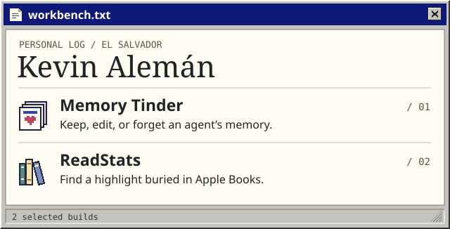

`01` [**Memory Tinder**](https://github.com/KevLehman/memory-tinder) · Review what Claude Code and Codex remember about a project. Swipe through the cards or stay in chat.

`02` [**ReadStats**](https://github.com/KevLehman/ReadStats) · Search your highlights across books from the Mac menu bar. [Inside the Apple Books database ↗](https://kevinaleman.com/the-apple-books-data-model-1f8h/)

[More from my Logbook ↗](https://kevinaleman.com/)
